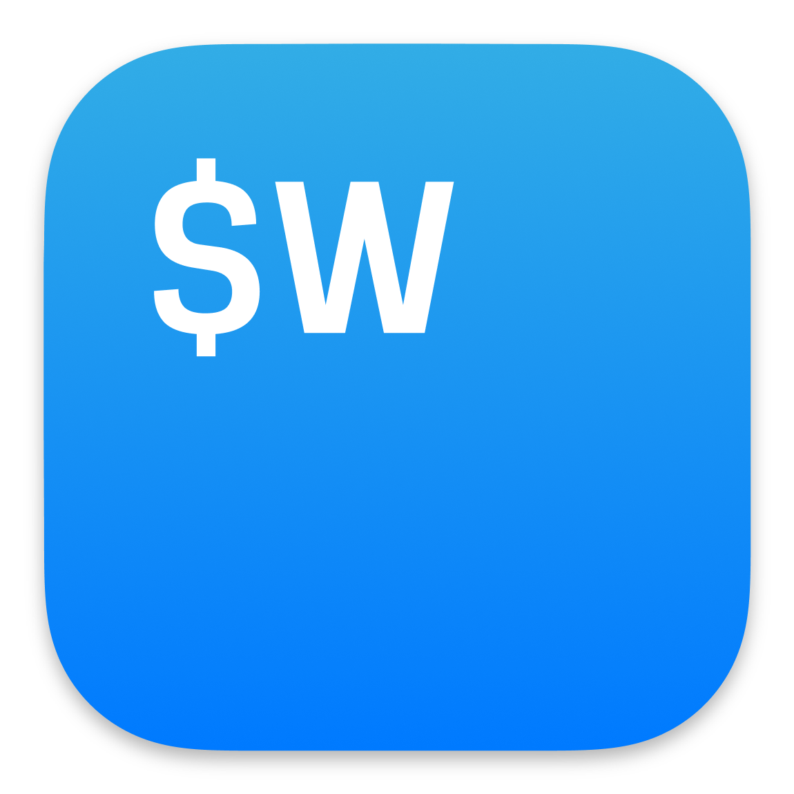
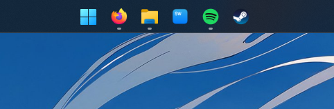

<div align="center">
  
  <h1>wezterm-config</h1>
  <p>My personal WezTerm setup — Windows host, WSL (Ubuntu) as the default shell.</p>
</div>

<div align="center">
  
</div>

## Install

WezTerm reads config from `%USERPROFILE%\.config\wezterm\wezterm.lua`, so clone this repo into `%USERPROFILE%\.config`.

```powershell
cd $env:USERPROFILE\.config
git clone https://github.com/luimedi/wezterm-config.git wezterm
```

Same thing in `cmd.exe`:

```bat
cd %USERPROFILE%\.config
git clone https://github.com/luimedi/wezterm-config.git wezterm
```

If `.config` doesn't exist yet:

```powershell
New-Item -ItemType Directory -Force "$env:USERPROFILE\.config"
```

Then reload with `CTRL+SHIFT+R`. Later updates: `git pull` inside the repo.

If you already have a `%USERPROFILE%\.wezterm.lua` of your own, back it up first — this config is meant to be edited freely, so expect to make it yours.

## Notes

- Assumes a WSL distro named `Ubuntu-26.04` is installed (see `config.default_domain`, run `wsl -l -v` if yours is named differently).
- Assumes **JetBrainsMono Nerd Font Mono** is installed on Windows. Needed for the icon glyphs in the tab bar.
- Edit anything. It's my dotfiles, not a curated template.

## Keys

Custom bindings from `wezterm.lua`.

### Tabs

| Key | Action |
| --- | --- |
| `CTRL+SHIFT+T` | New tab in the current domain |
| `CTRL+SHIFT+ALT+T` | New tab via `SpawnCommandInNewTab`, started in `~` |
| `CTRL+SHIFT+W` | Close current tab (no confirm) |
| `CTRL+SHIFT+←` | Previous tab |
| `CTRL+SHIFT+→` | Next tab |
| `CTRL+SHIFT+ALT+←` | Move tab left |
| `CTRL+SHIFT+ALT+→` | Move tab right |

These override WezTerm defaults: `CTRL+SHIFT+W` no longer asks to confirm, `CTRL+SHIFT+←/→` switches tabs instead of panes, and `CTRL+SHIFT+ALT+←/→` reorders instead of resizing.

### Mouse

| Gesture | Action |
| --- | --- |
| `ALT` + left click | Drag the window |

### Defaults still active

Everything below comes from WezTerm itself — `disable_default_key_bindings` is not set.

| Key | Action |
| --- | --- |
| `CTRL+SHIFT+C` / `CTRL+SHIFT+V` | Copy / paste |
| `CTRL+SHIFT+R` | Reload config |
| `CTRL+SHIFT+F` | Search scrollback |
| `CTRL+SHIFT+P` | Command palette |
| `CTRL+SHIFT+L` | Debug overlay |
| `CTRL+SHIFT+X` | Copy mode |
| `CTRL+SHIFT+U` | Character selector |
| `CTRL+SHIFT+K` | Clear scrollback |
| `CTRL+SHIFT+SPACE` | Quick select |
| `CTRL+SHIFT+Z` | Zoom pane |
| `CTRL+SHIFT+1..9` | Jump to tab N |
| `CTRL+SHIFT+N` | New window |
| `CTRL+SHIFT+ALT+"` | Split right |
| `CTRL+SHIFT+ALT+%` | Split down |
| `CTRL+SHIFT+↑` / `CTRL+SHIFT+↓` | Switch pane |
| `CTRL+SHIFT+ALT+↑` / `CTRL+SHIFT+ALT+↓` | Resize pane |
| `CTRL+PageUp` / `CTRL+PageDown` | Switch tab |
| `ALT+Enter` | Toggle fullscreen |
| `CTRL+-` / `CTRL+=` / `CTRL+0` | Font size down / up / reset |

`wezterm show-keys --lua` dumps the full resolved table.

## Config

| Option | Value | Notes |
| --- | --- | --- |
| `font` | `JetBrainsMono Nerd Font Mono` | Nerd Font glyphs for the tab bar |
| `default_domain` | `WSL:Ubuntu-26.04` | Tabs open in WSL |
| `window_decorations` | `INTEGRATED_BUTTONS \| RESIZE` | In-bar window buttons + resize border |
| `hide_tab_bar_if_only_one_tab` | `false` | Always show the tab bar |
| `color_scheme` | `Abernathy` | Built-in scheme |
| `front_end` | `WebGpu` | Fallback to `OpenGL` if it misbehaves |
| `max_fps` / `animation_fps` | `60` | Via the `fps` variable |
| `window_padding` | `0` on all sides | No inner margin |

## Icon

The default WezTerm logo is meh, so these replace it: `wezterm-sky.ico` (app icon) and `wezterm-sky.png` (preview).

Credit goes to [grapao](https://github.com/grapao), who shared the design in [this WezTerm discussion](https://github.com/wezterm/wezterm/discussions/2396) and linked his [Figma file](https://www.figma.com/community/file/1486670726006709753).